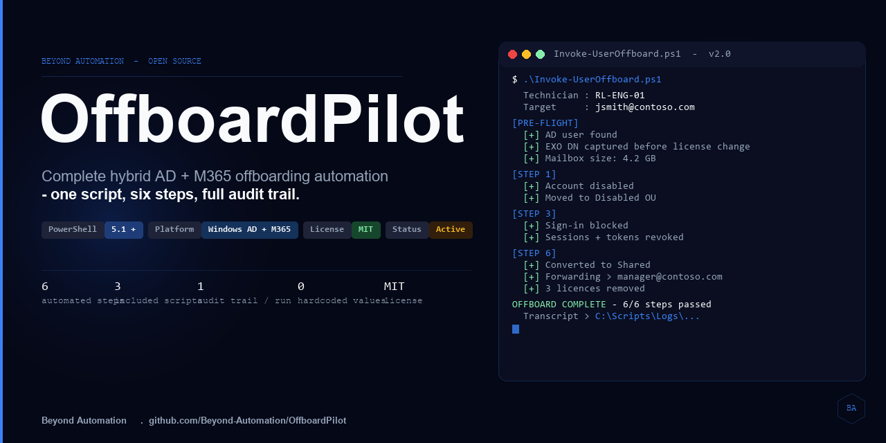

# OffboardPilot

**Complete hybrid AD + M365 employee offboarding automation — one script, six steps, full audit trail.**

*By [Beyond Automation](https://beyondautomation.io)*

---

## The problem with manual offboarding

Every time an employee leaves, the same checklist runs through your head. Miss one step and the audit finds it later.

There is also a silent bug in most offboarding scripts: when you remove a user's M365 license, Exchange Online reverts their primary email address from `user@yourdomain.com` back to `user@tenant.onmicrosoft.com`. Any script that filters distribution group memberships by email address — and most do — runs after the license removal, hits the wrong address, finds nothing, and reports success.

**The user is still in every cloud distribution list they were ever added to.**

OffboardPilot fixes this by capturing the user's Exchange Distinguished Name *before* any license changes, then using that DN for every group query. DN is stable regardless of licensing state.

---

## What it does

| Step | Action |
|------|--------|
| 1 | Disable on-premises Active Directory account |
| 2 | Block Entra ID sign-in |
| 3 | Revoke all active M365 sessions and OAuth tokens |
| 4 | Convert mailbox to Shared, configure forwarding, remove licenses |
| 5 | Remove cloud-only Exchange Online distribution group memberships |
| 6 | Remove on-premises AD group memberships (including AD-synced DLs) |

After all six steps, a **color-coded reconciliation report** shows pass/fail status for every action. Every run is logged to `C:\Scripts\Logs\` for your audit trail.

---

## What is included

| File | Purpose |
|------|---------|
| `Invoke-UserOffboard.ps1` | Main offboarding engine |
| `Get-EXOGroupMembership.ps1` | Diagnostic — audit a user's EXO group memberships before or after offboarding |
| `Reset-TestAccount.ps1` | Reset a test account back to active state for lab re-runs |

---

## Prerequisites

- Windows workstation joined to the domain
- PowerShell 5.1 or later
- RSAT: Active Directory Domain Services tools installed
- AD admin credentials with rights to disable accounts and modify group memberships
- Exchange Online admin or equivalent role
- Microsoft Graph permissions: `User.ReadWrite.All`, `Directory.ReadWrite.All`

Required PowerShell modules (`ActiveDirectory`, `ExchangeOnlineManagement`, `Microsoft.Graph.Authentication`) are checked at startup and auto-installed if missing.

---

## Supported workflows

### User with an Exchange Online mailbox

The full six-step pipeline runs. At the configuration prompt you choose:

- **No forwarding** — mailbox is converted to Shared and licenses are removed
- **Forwarding only** — mailbox converts to Shared, mail forwards to a recipient, licenses are removed
- **Forwarding + member access** — same as above, plus the forwarding recipient is granted Full Access to the mailbox in Outlook

If the mailbox is over 50 GB, the script warns you before proceeding and offers three options: convert and accept the quota risk, apply forwarding only and retain the license, or skip the mailbox step for manual handling.

### AD-only user (no Exchange Online mailbox)

The script detects the missing mailbox at pre-flight and continues without EXO steps. Steps 1 through 3 (AD disable, Entra ID block, session revoke) and Step 6 (AD group removal) run normally. EXO steps are clearly marked skipped in the reconciliation report.

---

## Lab guide

This lab guide uses fictional users and a test domain. No production accounts are needed.

### What you need

- A Windows Server VM running Active Directory (domain controller)
- Three test users in AD — for example: `jordan.reed`, `morgan.ellis`, `taylor.brooks`
- An M365 trial tenant with Exchange Online (optional — needed to test the mailbox path)
- Entra ID Cloud Sync or AD Connect configured if testing the hybrid path
- RSAT installed on the machine where you run the scripts

### Test path 1 — synced user with a mailbox

1. Confirm the test user has an Exchange Online mailbox and is synced from AD.
2. Run `Get-EXOGroupMembership.ps1` and record the user's cloud group memberships. This is your before state.
3. Run `Invoke-UserOffboard.ps1`. Enter the test user's email, select forwarding or no forwarding, and confirm execution.
4. Verify results:
   - AD account is disabled (`Get-ADUser -Identity <sam> | Select-Object Enabled`)
   - Entra ID sign-in is blocked (M365 Admin > Users > Active Users)
   - Mailbox type is Shared (`Get-Mailbox -Identity <email> | Select-Object RecipientTypeDetails`)
   - License is removed (M365 Admin > Licenses)
   - Cloud group memberships are cleared (run `Get-EXOGroupMembership.ps1` again)
5. Run `Reset-TestAccount.ps1` to restore the test user for another run.

### Test path 2 — AD-only user with no mailbox

1. Create a test user in AD with no M365 account or Exchange Online mailbox.
2. Add the user to at least one AD security group.
3. Run `Invoke-UserOffboard.ps1`. Enter the user's sAMAccountName when prompted.
4. Confirm that the script detects no EXO mailbox at pre-flight and proceeds without EXO steps.
5. Verify results:
   - AD account is disabled
   - AD group memberships are removed
   - Reconciliation report shows EXO steps as Skipped

**Expected result:** Steps 1, 2, 3, and 6 complete. Steps 4 and 5 show `Skipped - no EXO mailbox`. No errors.

---

## How to verify a run

The reconciliation report at the end of each run shows color-coded status for every step:

- **Green** — Completed successfully
- **Yellow** — Skipped (by design or technician choice) or partial completion
- **Red** — Failed (check the transcript for the error)

Every run writes a transcript to `C:\Scripts\Logs\Offboard_<email>_<date>.txt`. Review this file to confirm what ran and catch any step-level errors.

---

## Contributing

See [CONTRIBUTING.md](CONTRIBUTING.md) for how to report issues, suggest changes, and submit pull requests.

The lab guide above is designed so you can contribute without a production environment. If you run a test path and get a result that differs from what this README describes, that is worth reporting.

---

## About

Built by [Randall Lewis](https://beyondautomation.io), Senior Infrastructure Solutions Engineer.  
Part of the [Beyond Automation](https://beyondautomation.io) open-source toolkit for Windows IT infrastructure.

MIT License — see [LICENSE](LICENSE).

